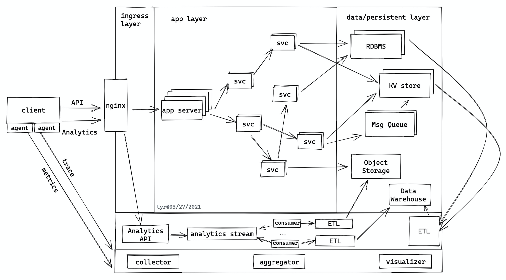

+++
title = "Writing Guide"
description = "A compact reference for Markdown, Serenity components, math, and charts."
draft = true
date = 2004-01-01
updated = 2026-10-15
aliases = ["/posts/visuals/", "/posts/writing/"]
[taxonomies]
categories = ["Guide"]
tags = ["serenity", "writing", "visualization"]
[extra]
lang = "en"
toc = true
code_copy = true
featured = true
math = true
mermaid = true
outdated_alert = true
outdated_alert_days = 0
+++

A working reference for writing with Serenity. Open `.md` in the footer to copy the complete source.

## Front matter

Create `content/blog/my-post/index.md`; keep attachments beside it. This guide is a draft: preview it with `zola serve --drafts`; set `draft = false` to publish. The old dates demonstrate the outdated alert.

```toml
# Wrap front matter in +++ delimiters.
title = "My post"
description = "A short summary" # Search and social previews
date = 2026-10-10
updated = 2026-10-11           # Optional update date
draft = false                # true: hide from production builds

[taxonomies]
tags = ["serenity", "writing"]
categories = ["Guide"]       # Group with section extra.categorized = true

[extra]
lang = "en"
toc = true                   # Fixed desktop TOC; highlights current section
code_copy = true             # Copy without line numbers; preserve whitespace
featured = true              # Asterisk in the post list
outdated_alert = true
outdated_alert_days = 90      # Days since the last update
math = true                  # KaTeX: LaTeX formulas
mermaid = true               # Mermaid diagrams
# ECharts needs no front matter switch.
# og_image = "cover.webp"    # Colocated image, static path, or full URL
# Display settings resolve: post → section → site [extra].
```

## Markdown syntax

Plain, **bold**, _italic_, _**bold italic**_, ~~strikethrough~~, `inline code`.

[External link](https://example.com) · <https://example.com> · [Internal link](@/blog/_index.md) · Footnote[^note]

- Unordered item
- Another item

1. Ordered item
   1. Nested item
2. Next item

| Default | Alignment |
| ------- | --------- |
| Cell    | Cell      |

| Left | Center | Right |
| :--- | :----: | ----: |
| Cell |  Cell  |   123 |

> Standard quote.
>
> > Nested quote.

---

### Multilingual text

한국어, 简体中文, 日本語

### Code

```
zola serve
```

```diff,linenos,linenostart=51
- old value
+ new value
```

```rs,linenos,hl_lines=3 4-8 11,name=src/main.rs
use std::{fs, io};

fn main() -> io::Result<()> {
    let text = fs::read_to_string("example.txt")?;
    // let text = fs::read_to_string("example.txt").unwrap_or_else(|err| {
    //     eprintln!("Failed to read file: {err}");
    //     String::new()
    // });
    println!("{}", text);

    Ok(())
}
```

### Images



## Extra Features

### Quotes, callouts, and disclosures


A quote without attribution.



A quote with attribution.



_An italic first paragraph._

A second paragraph.


> [!NOTE]
> Additional context.

> [!TIP]
> A useful tip.

> [!IMPORTANT]
> A key point.

> [!WARNING]
> Something to watch for.

> [!CAUTION]
> A risk to avoid.


**Markdown** inside a disclosure.


{{ <figure src="https://github.blog/wp-content/uploads/2022/09/garbagecollection4.gif" alt="" caption="**Figure 1.** A caption." width="480" page /> }}

### Math

Inline: $E = mc^2$.

$$
f(x) = \int_0^x t^2\mathrm{d}t
$$

$$
x = \frac{-b \pm \sqrt{b^2-4ac}}{2a}
$$

$$
\sum_{k=1}^{n} k = \frac{n(n+1)}{2}
$$

### Mermaid


sequenceDiagram
participant U as Reader
participant B as Blog
Note over U,B: Search example
U->>+B: Query
alt Results found
par Display
B-->>U: Post list
and Cache
B-->>B: Reuse index
end
else No results
B-->>U: Empty result
end
B-->>-U: Done


### ECharts

{{ <echarts js_file="heatmap.js" title="Perlin noise heatmap" page /> }}

{{ <echarts js_file="klein_bottle.js" title="Klein bottle" height="480px" gl={true} page /> }}

Charts resize automatically and redraw on light/dark changes, resetting interactions. Diagram and chart libraries load from a CDN; 3D charts also require WebGL.

### YouTube

{{ <youtube id="ueufxzUjsS0" /> }}

### Reading controls

- **Search:** Blog page icon or `/`; `Esc` to close, arrow keys to navigate. Searches titles, descriptions, and body text; excludes code blocks. Try `Markdown` for match highlighting.
- **Navigation:** fixed desktop TOC, heading anchors, and back-to-top button.
- **Footer:** light/dark switch and `.md` source in a new tab.

[^note]: A footnote with a return link.
